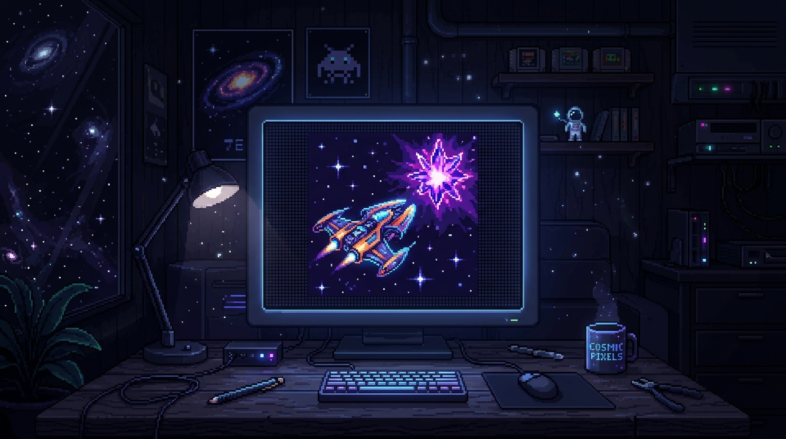
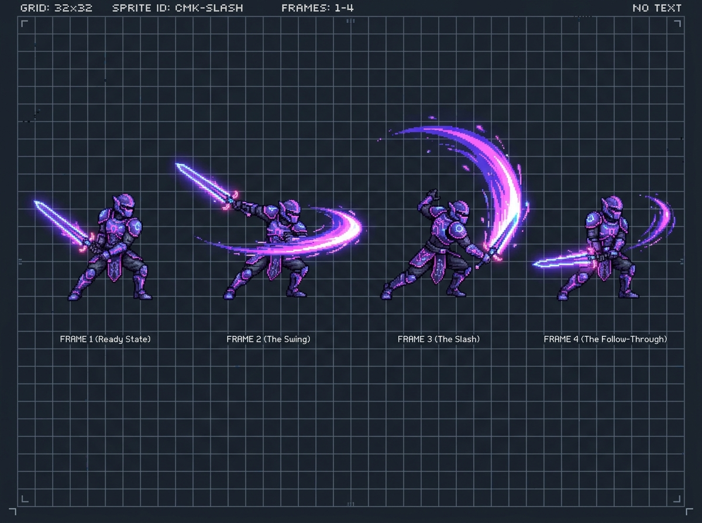
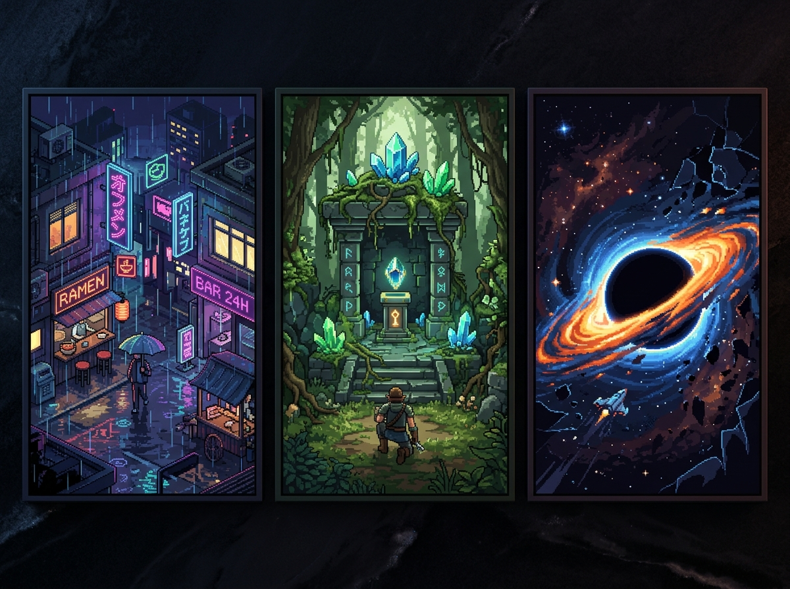

<div align="center">

<br />

# ✦ NOVABLAST ✦

### **Взрыв сверхновой в каждом пикселе!**

*Хардкорный редактор пиксель-арта и покадровой анимации с облачной синхронизацией, AI-генерацией спрайтов и нативной поддержкой Windows / Linux (Electron) и веб-версией приложения.*

<br />

[](https://www.typescriptlang.org/)
[](https://react.dev/)
[](https://tailwindcss.com/)
[](https://www.electronjs.org/)
[](https://firebase.google.com/)
[](./LICENSE)

<br />

[Возможности](#-возможности) •
[Веб vs Desktop](#-веб-версия-и-desktop-режим) •
[Горячие клавиши](#-горячие-клавиши) •
[Быстрый старт](#-локальный-запуск) •
[Деплой на Vercel](#-деплой-веб-версии-на-vercel) •
[Сборка .exe / Linux](#-сборка-десктопного-приложения)

<br />



</div>

---

## 🌌 О проекте

**NovaBlast** — это кроссплатформенная пиксель-арт студия, работающая по принципу **Discord / Steam**:
- На **веб-сайте** открывается приветственная витрина с описанием редактора, быстрыми пресетами холста, кнопкой перехода в браузерную версию (`/app`) и загрузкой установщика для Windows.
- В **десктопном приложении (Electron)** сайт пропускается — программа запускает вас напрямую в рабочую среду редактора с интеграцией **Discord Rich Presence** и нативным окном `1920×1080`.

---

## ✨ Возможности

<table>
  <tr>
    <td width="50%" valign="top">
      <h3>🎨 Студия пиксель-арта и симметрии</h3>
      <p>
        Точный контроль каждого пикселя с плавным зумом камеры, перетаскиваемой сеткой и неограниченной историей <code>Undo / Redo</code>:
      </p>
      <ul>
        <li><b>Инструменты:</b> Карандаш, Ластик, Заливка, Пипетка, Пиксельный градиент, Линия и Линейка (расстояние, угол Δ и область).</li>
        <li><b>Живая симметрия:</b> Вертикальная, горизонтальная и 4-сторонняя (квад) ось с перетаскиваемыми маркерами прямо на холсте и быстрым отзеркаливанием половин.</li>
        <li><b>Умная палитра:</b> Встроенные ретро-палитры + автоматическое отслеживание пользовательских цветов проекта.</li>
      </ul>
    </td>
    <td width="50%" valign="top">
      <h3>🎬 Покадровая анимация и Экспорт</h3>
      <p>
        Полноценный таймлайн для создания спрайт-анимаций и экспорта в игровые движки:
      </p>
      <ul>
        <li><b>Таймлайн до 60 FPS:</b> Создание, дублирование, удаление и воспроизведение кадров по нажатию <code>Space</code>.</li>
        <li><b>Режим кальки (Onion Skin):</b> Полупрозрачное наложение предыдущего кадра для плавных переходов.</li>
        <li><b>Экспорт (PNG / GIF / ZIP):</b> Зацикленный <code>.gif</code> на базе <code>gifenc</code>, спрайт-лист (лента или матрица) или <code>.zip</code> архив кадров с масштабированием без размытия.</li>
      </ul>
    </td>
  </tr>
  <tr>
    <td width="50%" valign="top">
      
    </td>
    <td width="50%" valign="top">
      
    </td>
  </tr>
  <tr>
    <td width="50%" valign="top">
      <h3>🧠 Нейро-спрайт (AI-генератор)</h3>
      <p>
        Встроенный помощник на базе <b>Gemini API</b> (<code>@google/genai</code>), который создаёт новые пиксельные объекты или дорабатывает ваш текущий рисунок с грамотным шейдингом и градиентами прямо внутри сетки холста.
      </p>
    </td>
    <td width="50%" valign="top">
      <h3>☁️ Облако, Steam и Галерея сообщества</h3>
      <p>
        Единое облако <b>Firebase Firestore</b> связывает браузер и ПК-клиент:
      </p>
      <ul>
        <li>Авторизация через <b>Google</b>, <b>Почту/Ник</b>, <b>GitHub</b>, <b>X</b> и <b>Steam</b> (OpenID 2.0 + официальный <b>Steam Guard QR</b>).</li>
        <li>Публикация готовых артов и анимаций в общую <b>Галерею сообщества</b>, просмотры и скачивание.</li>
      </ul>
    </td>
  </tr>
</table>

---

## 💻 Веб-версия и Desktop-режим

| Функция | 🌐 Веб-версия (Vercel / Браузер) | 🖥️ Desktop (Windows / Linux Electron) |
| :--- | :--- | :--- |
| **Стартовый экран** | Витрина приложения с описанием и скачиванием | Сразу лаунчер и редактор (без лендинга) |
| **Запуск** | Мгновенно в браузере по маршруту `/app` | Автономное окно `1920×1080` |
| **Все инструменты и экспорт** | ✅ Полный набор | ✅ Полный набор |
| **Облачное сохранение** | ✅ Синхронизировано через Firebase | ✅ Синхронизировано через Firebase |
| **Discord Rich Presence** | — | ✅ Отображает проект и активный инструмент |
| **Внешняя OAuth-авторизация** | Стандартные окна браузера | ✅ Встроенный локальный OAuth-мост |

---

## ⌨️ Горячие клавиши

Все комбинации можно переназначить в настройках редактора (**Настройки → Горячие клавиши**):

| Клавиша | Действие | Клавиша | Действие |
| :---: | :--- | :---: | :--- |
| **`B`** | Карандаш | **`M`** | Линейка (измерение угла и дистанции) |
| **`E`** | Ластик | **`X`** | Зеркало (симметрия осей) |
| **`F`** | Заливка области | **`H`** | Показать / скрыть сетку пикселей |
| **`P`** | Пипетка цвета | **`S`** | Плавное изменение размера кисти |
| **`G`** | Градиент | **`Space`** | Пуск / Пауза анимации |
| **`L`** | Прямая линия | **`Ctrl + Z`** / **`Ctrl + Shift + Z`** | Отменить / Повторить шаг |

---

## 🚀 Локальный запуск

### 1. Клонирование и установка зависимостей
```bash
git clone https://github.com/bobPingvin/NovaBlast.git
cd NovaBlast
npm install
```

### 2. Настройка переменных окружения
Скопируйте шаблон `.env.example` в `.env` и заполните нужные ключи:
```bash
cp .env.example .env
```

<details>
<summary><b>Список поддерживаемых переменных в .env</b></summary>

| Переменная | Назначение |
| :--- | :--- |
| `GEMINI_API_KEY` | Ключ API для генератора «Нейро-спрайт» |
| `STEAM_API_KEY` | Ключ Steam Web API (ник и аватар профиля Steam) |
| `FIREBASE_SERVICE_ACCOUNT` | JSON сервисного аккаунта Firebase Admin для облачных токенов Steam/GitHub/X |
| `STEAM_SESSION_SECRET` | Секрет для подписи HMAC-сессий авторизации |
| `GITHUB_CLIENT_ID` / `GITHUB_CLIENT_SECRET` | OAuth-ключи для входа через GitHub |
| `X_CLIENT_ID` / `X_CLIENT_SECRET` | OAuth-ключи для входа через X |
| `VITE_WINDOWS_DOWNLOAD_URL` | Прямая ссылка на установщик `.exe` для кнопки скачивания на сайте |

</details>

### 3. Запуск в режиме разработки
```bash
# Веб-версия + Express-сервер на http://localhost:3000
npm run dev

# Или запуск сразу в окне десктопного приложения Electron
npm run dev:electron
```

---

## ▲ Деплой веб-версии на Vercel

Проект уже включает сконфигурированный [`vercel.json`](./vercel.json) для SPA-маршрутов (`/` и `/app`).

1. Загрузите репозиторий на **GitHub** и импортируйте его в **Vercel** (*Framework Preset: `Vite`*).
2. Проверьте команды сборки:
   - **Build Command:** `npm run build`
   - **Output Directory:** `dist`
3. В разделе **Environment Variables** добавьте `VITE_WINDOWS_DOWNLOAD_URL` со ссылкой на ваш релиз `.exe` (например, из GitHub Releases), чтобы кнопка **«Скачать для Windows»** на главной странице сразу отдавала установщик. *(Альтернативно можно положить файл напрямую в `public/downloads/NovaBlast-Setup.exe`)*.
4. Добавьте домен Vercel (например, `your-app.vercel.app`) в **Firebase Console → Authentication → Settings → Authorized domains**, чтобы работали вход через Google и облачные сохранения.

---

## 📦 Сборка десктопного приложения

Конфигурация `electron-builder` уже настроена в `package.json` (`NSIS` для Windows, `AppImage` / `deb` / `rpm` для Linux, `DMG` для macOS):

```bash
# Сборка установщика для текущей платформы (результат появится в папке release/)
npm run build:electron

# Сборка пакетов для Linux
npm run build:linux      # AppImage
npm run build:linux-deb  # Debian / Ubuntu (.deb)
npm run build:linux-rpm  # ALT / Fedora / Red Hat (.rpm)
```

---

## 🗂️ Структура проекта

```text
NovaBlast/
├── App.tsx                     # Главный оркестратор студии и маршрутизация Веб/Electron
├── server.ts                   # Express-сервер: OAuth (Steam OpenID/QR, GitHub, X) + Vite
├── main.cjs & preload.cjs      # Главный процесс Electron, Stealth-OAuth и Discord RPC
├── vercel.json                 # Конфигурация SPA-маршрутов для хостинга Vercel
├── components/
│   ├── WebLandingPage.tsx      # Веб-витрина для браузера и скачивания под Windows
│   ├── WelcomeScreen.tsx       # Лаунчер проекта (Новый арт, Мои проекты, Настройки)
│   ├── Canvas.tsx              # Пиксельный холст с зумом, сеткой, линейкой и симметрией
│   ├── Tools.tsx & Palette.tsx # Панель инструментов, размер кисти и палитра цветов
│   ├── FramesTimeline.tsx      # Покадровая анимация, FPS и режим кальки (Onion Skin)
│   ├── NeuroSpriteModal.tsx    # AI-генерация и доработка спрайтов
│   ├── ExportModal.tsx         # Экспорт в PNG, GIF, спрайт-листы и ZIP-архивы
│   ├── CommunityGalleryModal.tsx # Галерея работ сообщества
│   └── AuthModal.tsx           # Вход: Google, Email, Steam (OpenID / QR), GitHub, X
├── services/aiService.ts       # Интеграция генератора пиксель-арта с Gemini API
└── src/
    ├── l10n.ts                 # Двуязычная локализация интерфейса (RU / EN)
    └── lib/firebase.ts         # Клиент Firebase Auth и Cloud Firestore
```

---

<div align="center">

### ⚡ Контакты автора и сообщество

Сделано с ❤️ автором **bob_pingvin**

[](https://t.me/ChOTblPE)
[](https://discord.gg/mcSZ2X2B)
[](https://steamcommunity.com/id/bobpingvin/)
[](https://github.com/bobPingvin)

<br />

<sub>© NovaBlast • Распространяется под лицензией MIT</sub>

</div>
